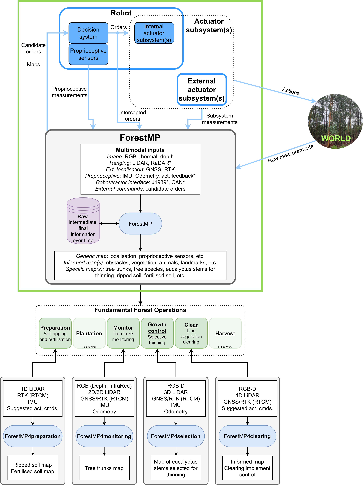

# Projects

Selected research and engineering work in robotics, artificial intelligence and embedded systems.

## <a href="https://www.inesctec.pt/pt/projetos/agendatransform" target="_blank" rel="noopener noreferrer">AgendaTransform</a>

  
  

    
Agenda for the digital transformation of the forestry sector for a resilient and low-carbon economy.

    
Forestry · Digital transformation · Robotics

  

---

## <a href="https://www.researchgate.net/publication/384288274_Multimodal_Perception_for_Robotics_in_Forestry_Operations" target="_blank" rel="noopener noreferrer">ForestMP perception platform</a>

  
  

    
ForestMP is a multipurpose, multimodal perception system for stand-level forestry robotics. It fuses heterogeneous sensors into meaningful perceptions that support soil preparation, trunk monitoring and mapping, selective thinning and vegetation clearing.

    
Sensor fusion · Computer vision · Field robotics

  

---

## <a href="https://www.inesctec.pt/en/projects/smartcut" target="_blank" rel="noopener noreferrer">SMARTCUT</a>

Remote diagnosis and maintenance, and simulators for forestry-machine operation and maintenance training.

Forestry machinery · Remote maintenance · Training simulators

---

## <a href="https://www.inesctec.pt/pt/projetos/replant" target="_blank" rel="noopener noreferrer">rePLANT</a>

  
  

    
Implementation of collaborative strategies for integrated forest and fire management.

    
Forest management · Fire resilience · Collaborative systems

  

---

## <a href="https://hdl.handle.net/10216/132839" target="_blank" rel="noopener noreferrer">Tactode computer vision system</a>

  <iframe class="embed" src="https://www.youtube.com/embed/AexTj4I-ry8" title="Tactode computer vision system demonstration" loading="lazy" allow="accelerometer; autoplay; clipboard-write; encrypted-media; gyroscope; picture-in-picture" allowfullscreen></iframe>
  

    
Tactode makes robot programming more accessible to children through puzzle-like tangible code. This dissertation developed a computer-vision system that detects and identifies pieces in photographed Tactode programs without relying on ArUco markers.

    
Computer vision · Tangible programming · Robotics education

    
<a href="https://github.com/daniqsilva25/tactode_recognition" target="_blank" rel="noopener noreferrer">View the GitHub repository →</a>

  

---

## The Maze in QVGA

  <iframe class="embed" src="https://www.youtube.com/embed/yIrrkUGHrhg" title="The Maze in QVGA demonstration" loading="lazy" allow="accelerometer; autoplay; clipboard-write; encrypted-media; gyroscope; picture-in-picture" allowfullscreen></iframe>
  

    
A maze game using an Arduino Due to control a QVGA display interface.

    
Embedded systems · Arduino Due · Graphics interface

  

